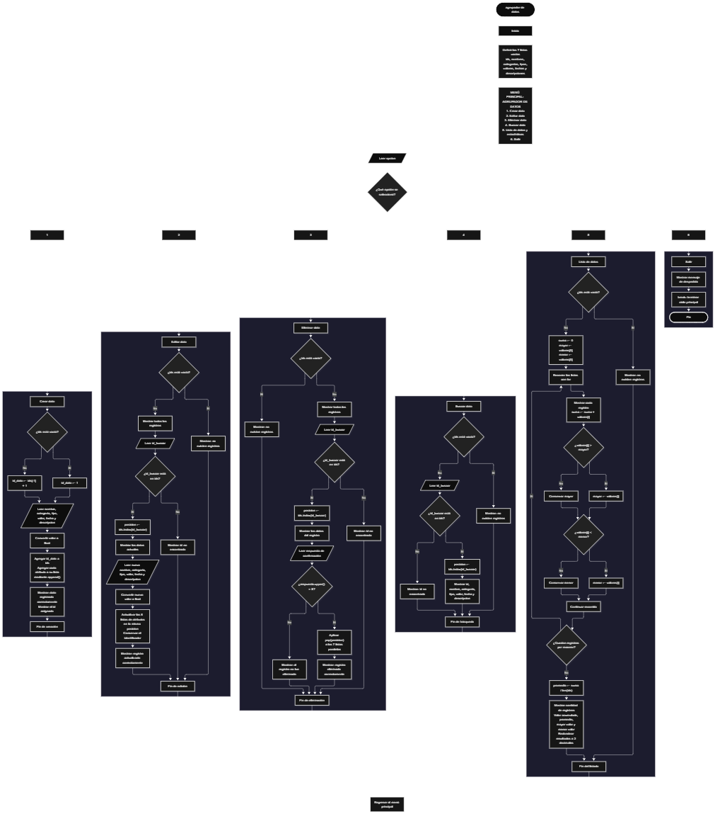

 

Este proyecto, llamado <b>agrupador de datos</b>, fue desarrollado en <b>python</b> como un ejercicio práctico para fortalecer la lógica de programación mediante la creación de un sistema de gestión de datos desde la consola. El programa cuenta con un menú principal de seis opciones que permite <b>crear, editar, eliminar, buscar y listar datos</b>, además de calcular estadísticas generales sobre los valores registrados. Cada registro almacena información como el nombre, la categoría, el tipo, el valor, la fecha y la descripción, utilizando siete listas paralelas que mantienen relacionados los datos de cada registro durante la ejecución. Durante su desarrollo se aplicaron conceptos fundamentales de programación, como variables, listas, estructuras condicionales, ciclos repetitivos y operaciones para buscar, modificar, eliminar y organizar registros. Este proyecto permite poner en práctica los conocimientos adquiridos en Python y sirve como base para desarrollar sistemas de gestión más avanzados.

<h2 align="center">⚙️ Funcionamiento del menú principal</h2>

### ➕ Crear dato

La opción <b>1) crear dato</b> permite registrar un nuevo dato en el sistema. Antes de realizar el registro, el programa comprueba si la lista de identificadores <b>ids</b> está vacía. Si no existen registros, asigna el identificador <b>1</b>; de lo contrario, obtiene el último identificador almacenado y le suma uno mediante la expresión <b>ids[-1] + 1</b>. Después, solicita el <b>nombre, categoría, tipo, valor, fecha y descripción</b> del dato. El valor se convierte a número decimal utilizando la función <b>float()</b>. Finalmente, almacena cada atributo en su lista correspondiente mediante el método <b>append()</b> y muestra el mensaje <b>"dato registrado correctamente."</b>, junto con el identificador asignado.

### ✏️ Editar dato

La opción <b>2) editar dato</b> permite modificar la información de un registro existente. Primero, el programa comprueba si la lista <b>ids</b> está vacía. Si no hay registros, muestra el mensaje <b>"no existen registros."</b>. En caso contrario, presenta una lista con los identificadores y los datos almacenados. Después, solicita el identificador del registro que se desea editar y comprueba si se encuentra en la lista <b>ids</b>. Si existe, utiliza el método <b>index()</b> para obtener la posición correspondiente, muestra los datos actuales y solicita el nuevo nombre, categoría, tipo, valor, fecha y descripción. El identificador original se conserva, mientras que el valor actualizado se convierte mediante <b>float()</b>. Finalmente, presenta el mensaje <b>"registro actualizado correctamente."</b>. Si el identificador no existe, muestra el mensaje <b>"id no encontrada."</b>.

### 🗑️ Eliminar dato

La opción <b>3) eliminar dato</b> permite eliminar un registro almacenado en el sistema. Primero, el programa comprueba si existen registros. Si la lista <b>ids</b> está vacía, muestra el mensaje <b>"no existen registros."</b>. Si hay datos disponibles, presenta una lista con la información de los registros y solicita el identificador que se desea eliminar. Cuando encuentra el identificador, obtiene su posición mediante <b>index()</b> y muestra los datos correspondientes. Después, solicita confirmación mediante la pregunta <b>"¿desea eliminar este registro? (s/n):"</b>. Si la respuesta es <b>s</b> o <b>S</b>, utiliza el método <b>pop()</b> para eliminar los elementos de esa misma posición en las siete listas: <b>ids, nombres, categorias, tipos, valores, fechas y descripciones</b>. Finalmente, muestra el mensaje <b>"registro eliminado correctamente."</b>. Si el usuario introduce otra respuesta, muestra <b>"el registro no fue eliminado."</b>. Si el identificador no existe, presenta el mensaje <b>"id no encontrada."</b>.

### 🔎 Buscar dato

La opción <b>4) buscar dato</b> permite localizar un registro mediante su identificador. Primero, el programa comprueba si existen datos almacenados. Si la lista <b>ids</b> está vacía, muestra el mensaje <b>"no existen registros."</b>. En caso contrario, solicita el identificador que se desea buscar y comprueba si está presente en la lista. Si encuentra una coincidencia, utiliza <b>index()</b> para obtener la posición del registro y muestra toda su información: identificador, nombre, categoría, tipo, valor, fecha y descripción. Si el identificador no está registrado, presenta el mensaje <b>"id no encontrada."</b>. Esta función facilita la consulta de un registro sin necesidad de recorrer manualmente toda la información.

### 📋 Lista de datos

La opción <b>5) lista de datos</b> permite visualizar todos los registros almacenados y obtener estadísticas generales sobre sus valores. Antes de comenzar, el programa comprueba si la lista <b>ids</b> está vacía. Si no existen registros, muestra el mensaje <b>"no existen registros."</b>. Si hay datos disponibles, inicializa la variable <b>suma</b> en cero y establece las variables <b>mayor</b> y <b>menor</b> con el primer valor de la lista <b>valores</b>. Después, utiliza un ciclo <b>for</b> para recorrer los registros, mostrar su información, acumular los valores y comparar cada uno para identificar el mayor y el menor. Al finalizar, calcula el promedio mediante la expresión <b>suma / len(ids)</b> y muestra la cantidad de registros, el valor acumulado, el promedio, el mayor valor y el menor valor. Los resultados estadísticos se presentan con dos decimales utilizando la función <b>round()</b>.

### 🚪 Salir del menú principal

La opción <b>6) salir</b> permite finalizar la ejecución del programa. Cuando el usuario selecciona esta opción, se muestra el mensaje <b>"gracias por utilizar el agrupador de datos."</b> y se utiliza la instrucción <b>break</b> para interrumpir el ciclo principal. El menú se encuentra dentro de una estructura repetitiva <b>while True</b>, que mantiene el programa en funcionamiento hasta que se selecciona la opción de salida. Si el usuario introduce una opción diferente de las disponibles, el programa muestra el mensaje <b>"opción no válida."</b> y vuelve a presentar el menú principal.

<h2 align="center">🧠 Temas aplicados en el proyecto</h2>

### 📦 Variables

En este proyecto se utilizan variables para almacenar temporalmente la opción seleccionada en el menú, los datos introducidos por el usuario, el identificador del registro que se desea consultar, la posición de los registros y los resultados de las estadísticas. Cada variable cumple una función específica dentro de las operaciones de gestión de datos.

🔢 **opcion:** Almacena la opción seleccionada por el usuario en el menú principal.

🆔 **id_dato:** Almacena el identificador asignado al nuevo registro.

🔎 **id_buscar:** Almacena el identificador introducido para buscar, editar o eliminar un registro.

📍 **posicion:** Indica la posición del registro encontrado dentro de las listas.

📝 **nombre, categoria, tipo, fecha y descripcion:** Almacenan temporalmente los datos introducidos durante la creación de un registro.

💰 **valor:** Almacena el valor numérico de un registro y se convierte a tipo decimal mediante <b>float()</b>.

📊 **suma:** Acumula los valores de los registros durante el cálculo de las estadísticas.

📈 **mayor:** Almacena el mayor valor encontrado durante el recorrido de los registros.

📉 **menor:** Almacena el menor valor encontrado durante el recorrido de los registros.

🧮 **promedio:** Almacena el resultado de dividir la suma de los valores entre la cantidad de registros.

🔄 **i:** Funciona como contador en los ciclos <b>for</b> utilizados para recorrer las listas.

### 🗃️ Listas

En este proyecto se utilizan siete listas paralelas relacionadas con los datos de cada registro. A diferencia de los arreglos de tamaño fijo, estas listas se crean vacías y pueden aumentar o disminuir de tamaño durante la ejecución. Todas utilizan la misma posición para representar la información correspondiente a un mismo dato. Por ejemplo, el registro ubicado en la posición <b>0</b> relaciona los elementos <b>ids[0], nombres[0], categorias[0], tipos[0], valores[0], fechas[0] y descripciones[0]</b>. Esta organización permite recorrer, buscar, modificar, mostrar y eliminar los registros de manera ordenada.

🆔 **ids:** Almacena los identificadores de los registros.

📝 **nombres:** Almacena los nombres de los datos registrados.

🗂️ **categorias:** Almacena las categorías asociadas a los registros.

🏷️ **tipos:** Almacena los tipos de datos.

💰 **valores:** Almacena los valores numéricos de los registros.

📅 **fechas:** Almacena las fechas asociadas a los datos.

📄 **descripciones:** Almacena las descripciones de los registros.

### 🔀 Estructuras condicionales

En este proyecto se utilizan las estructuras <b>if</b>, <b>elif</b> y <b>else</b> para controlar las opciones del menú, comprobar si existen registros antes de ejecutar determinadas operaciones, verificar si un identificador está almacenado y determinar si se confirma o se cancela una eliminación. Estas condiciones permiten que el programa responda de manera diferente según el estado de las listas y el resultado de cada comprobación. También se utiliza una condición para identificar las opciones del menú que no corresponden a ninguna de las operaciones disponibles.

### 🔄 Estructuras repetitivas

En este proyecto se utilizan los ciclos <b>while</b> y <b>for</b>. El ciclo <b>while True</b> mantiene activo el menú principal para que el usuario pueda realizar distintas operaciones antes de salir del programa. Por otro lado, los ciclos <b>for</b> permiten recorrer las listas para mostrar los registros almacenados y calcular las estadísticas. Durante el listado, el recorrido permite acumular los valores y comparar sus cantidades para obtener el mayor y el menor. Finalmente, la instrucción <b>break</b> interrumpe el ciclo principal cuando el usuario selecciona la opción de salida.

### 🎯 Estructura de selección

El programa evalúa la opción almacenada en la variable <b>opcion</b> mediante una cadena de condiciones <b>if</b>, <b>elif</b> y <b>else</b>. Cada condición representa una operación específica del sistema: <b>crear, editar, eliminar, buscar, listar o salir</b>. Cuando la opción introducida coincide con una de las alternativas, se ejecuta el bloque correspondiente. Si no coincide con ninguna, se utiliza el bloque <b>else</b> para mostrar el mensaje <b>"opción no válida."</b>.

### 🔢 Dimensionamiento de listas

El programa utiliza listas dinámicas de Python para almacenar la información de los registros. Las siete listas se inicializan vacías y no requieren una instrucción de dimensionamiento ni una capacidad máxima establecida previamente. El método <b>append()</b> incorpora nuevos elementos al final de las listas, mientras que <b>pop()</b> elimina los elementos de la posición indicada. La cantidad actual de registros se obtiene mediante <b>len(ids)</b>, que permite comprobar si existen datos y calcular el promedio de los valores almacenados.

### 🔄 Reorganización de registros

Cuando se selecciona un registro para eliminarlo, el programa obtiene su posición mediante el método <b>index()</b> aplicado a la lista <b>ids</b>. Después, utiliza el método <b>pop()</b> en esa misma posición de las siete listas paralelas. De esta manera, elimina los atributos correspondientes al mismo registro y mantiene la relación entre los datos restantes. Python reorganiza automáticamente las posiciones de los elementos posteriores después de cada eliminación, por lo que no es necesario implementar un ciclo adicional para desplazarlos.

<h2 align="center">¿Cómo se implementaron las operaciones crud en el proyecto?</h2>

Las operaciones <b>crud</b> se implementaron mediante las opciones del menú principal, permitiendo administrar los registros almacenados. La operación <b>crear</b> corresponde a <b>crear dato</b>, donde se introducen los atributos de un nuevo registro; <b>leer</b> se realiza mediante las opciones <b>buscar dato y lista de datos</b>, que permiten consultar los registros y visualizar sus estadísticas; <b>actualizar</b> corresponde a <b>editar dato</b>, donde se modifican los atributos de un registro existente; y <b>eliminar</b> se realiza mediante la opción <b>eliminar dato</b>, que solicita confirmación antes de quitar la información de las listas. Estas operaciones utilizan variables, listas, estructuras condicionales y ciclos para gestionar los datos almacenados temporalmente durante la ejecución del programa.

<h2 align="center">Diagrama de flujo del proyecto</h2>

El siguiente diagrama de flujo representa la organización del programa, desde el menú principal hasta las operaciones de creación, edición, eliminación, búsqueda y listado de datos. También muestra el proceso para calcular las estadísticas y la opción que permite finalizar la ejecución del sistema.

<h2 align="center">🛡️ Validaciones del programa</h2>

### 📭 No existen registros

Esta comprobación se utiliza en las opciones de <b>editar, eliminar, buscar y lista de datos</b>. El programa verifica si la lista <b>ids</b> tiene una longitud igual a cero mediante la condición <b>len(ids) == 0</b>. Si no existen registros almacenados, muestra el mensaje <b>"no existen registros."</b> y evita continuar con la operación correspondiente. Esta comprobación también impide que el cálculo de las estadísticas acceda a la primera posición de la lista <b>valores</b> cuando está vacía.

### 🔎 Identificador no encontrado

Esta comprobación se utiliza en las operaciones de <b>editar, eliminar y buscar dato</b>. Después de solicitar el identificador, el programa verifica si el valor de <b>id_buscar</b> se encuentra en la lista <b>ids</b>. Si existe, obtiene su posición mediante <b>index()</b> y accede a los datos relacionados. Si no existe, muestra el mensaje <b>"id no encontrada."</b>. Esta comprobación permite evitar el acceso a un registro cuyo identificador no está almacenado en la lista.

### ⚠️ Confirmación de eliminación

Antes de eliminar un registro, el programa solicita al usuario una confirmación. La respuesta se convierte a mayúscula mediante el método <b>upper()</b> y se compara con el carácter <b>"S"</b>. Si coincide, se ejecuta la eliminación en las siete listas. Si la respuesta es diferente, el programa cancela la operación y muestra el mensaje <b>"el registro no fue eliminado."</b>. Esta comprobación permite evitar que la eliminación se realice sin la confirmación esperada.

### 🔢 Conversión de valores numéricos

El programa utiliza la función <b>int()</b> para convertir el identificador introducido por el usuario en un número entero durante las operaciones de edición, eliminación y búsqueda. Por otro lado, utiliza <b>float()</b> para convertir el valor registrado o actualizado en un número decimal. El código no incluye un manejo de excepciones para entradas que no puedan convertirse, por lo que introducir un valor no numérico en estos campos puede interrumpir la ejecución del programa.

### ⚠️ Opción inválida

El menú principal utiliza una cadena de condiciones <b>if</b> y <b>elif</b> para reconocer las seis opciones disponibles. El bloque <b>else</b> muestra el mensaje <b>"opción no válida."</b> cuando el usuario introduce una opción diferente de las definidas. Después de mostrar el mensaje, el ciclo <b>while True</b> permite regresar al menú principal y seleccionar otra operación.

<h2 align="center">🎯 Objetivo del proyecto</h2>

El objetivo principal de este proyecto es fortalecer la <b>lógica de programación</b> mediante el desarrollo de un sistema de gestión de datos en <b>python</b>. A través de su construcción se busca aplicar los conocimientos adquiridos sobre variables, listas, estructuras condicionales, ciclos repetitivos y estructuras de selección, integrándolos para resolver un problema de manera organizada. Además, el proyecto permite comprender cómo registrar, consultar, modificar y eliminar información, así como realizar cálculos estadísticos básicos sobre los valores almacenados. Estos conocimientos sirven como base para desarrollar sistemas de gestión más completos utilizando otros lenguajes y tecnologías.

